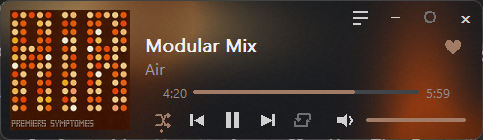
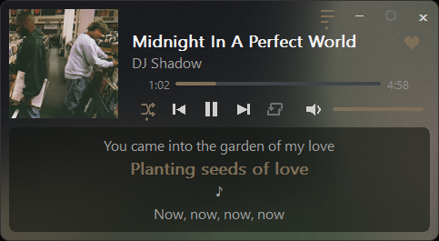

# Music Player Widget

A tiny native Windows widget that shows what Spotify is playing and controls it. It sits on your desktop, wears the colors of the album art, and uses almost no memory or CPU.

**Website: https://notkazhons.github.io/music-player-widget/**





It does not play audio. Spotify keeps playing; the widget is a remote and a display.

## Features

- Title, artist and album art, updated the moment the track changes.
- Play/pause, previous, next, a progress bar you can click or drag to seek, and elapsed/total time.
- Shuffle, repeat (off, list, track), mute, and a volume slider for Spotify's level.
- A heart that saves the current track to your Liked Songs (needs a one-time setup, see below).
- A copy button next to the heart that puts the song's Spotify link on the clipboard. With Spotify connected it is the exact track link; without, a Spotify search link for the song.
- Synced lyrics in a translucent box, from [LRCLIB](https://lrclib.net). Plain lyrics scroll with the mouse wheel when there are no timestamps.
- A slow, flowing gradient behind everything, colored from the album art. It only animates while a track plays.
- Dark and light theme (follows Windows), accent color from the art, crisp at 100% to 200% display scaling.
- Drag the left or right edge to change the width. Drag anywhere else to move it.
- Pin button (always on top or a normal window), minimize to the tray, and a tray menu.
- Opens by itself when Spotify opens, if you turn on "Start with Windows".

## Requirements

- Windows 10 or 11, 64-bit.
- The Spotify desktop app.
- Nothing else to install. It is a single `.exe` with no runtime, no Electron and no .NET.

## Install

1. Download the zip from the [Releases](../../releases) page and unzip it anywhere.
2. Run `music-player-widget.exe`.
3. Right-click the tray icon and tick **Start with Windows** if you want it to start at login. It then waits in the tray and shows itself when Spotify opens.

To remove it, untick **Start with Windows**, choose **Quit** from the tray menu, and delete the exe and the folder `%APPDATA%\music-player-widget`.

## Using it

| Do this | To get this |
|---|---|
| Drag the widget | Move it. The position is saved. |
| Drag the left or right edge | Change the width (340 to 900 px at 100% scaling). Saved. |
| Pin button (ring) | Ring bright: always on top. Ring dim: a normal window that sits behind your apps. |
| Minimize (dash) | Hide to the tray. Click the tray icon to bring it back. |
| Lyrics button (three lines) | Open or close the lyrics box. |
| Space, Left, Right (widget focused) | Play/pause, previous, next. |
| Tray icon, left click | Show or hide. |
| Tray icon, right click | Hide/Show, Start with Windows, Connect/Disconnect Spotify, Quit. |

## Like button setup

Everything above works without logging in. Only the heart needs the Spotify Web API, because Windows does not expose "like" for any music app. You use your own free Spotify developer app, so nothing is shared with anyone else.

1. Go to the [Spotify developer dashboard](https://developer.spotify.com/dashboard) and create an app. The app owner needs Spotify Premium.
2. In the app's settings, add this redirect URI exactly: `http://127.0.0.1:8888/callback`
3. Copy the app's **Client ID**.
4. Click the heart in the widget (or choose **Connect Spotify** in the tray menu). It opens `%APPDATA%\music-player-widget\spotify.txt`. Paste the Client ID on its own line below the comments and save.
5. Click the heart again. Your browser opens the Spotify approval page. Approve it once.

After that the heart shows whether the playing track is in Liked Songs, and clicking it adds or removes the track. Choose **Disconnect Spotify** in the tray menu to sign out.

The sign-in uses OAuth with PKCE, so there is no client secret. The refresh token is kept in Windows Credential Manager. If something fails, Spotify's error text is written to `%APPDATA%\music-player-widget\spotify.log` (no tokens in it).

If sign-in says "Port 8888 is busy", close the program using that port and try again.

## Resource use

Measured on the release build with Spotify playing, over 10 to 15 seconds per state. CPU is the share of the whole machine.

| State | CPU | Private working set |
|---|---|---|
| Playing, visible | 0.05% | 5.0 MB |
| Playing, hidden | 0.00% | 1.7 MB |
| Paused, visible | 0.16% | 3.0 MB |
| Paused, hidden | 0.04% | 2.2 MB |

The exe is about 620 KB. Hiding the widget frees the album art and lyrics. The redraw timer (20 times a second, for the gradient and progress bar) runs only while a track plays and the widget is visible.

## What it talks to

- **Windows media session (SMTC).** Title, artist, art, position, play state, and play/pause/next/previous/seek/shuffle/repeat. No login and no network.
- **Windows audio mixer.** Spotify's volume and mute, separate from the slider inside Spotify.
- **LRCLIB** (`lrclib.net`, no key). Only while the lyrics box is open. It is sent the track's artist, title, album and length.
- **Spotify Web API.** Only after you connect, and only for the heart: it reads the playing track and your saved-track status, and saves or removes the track.

No analytics, no telemetry, no other network traffic. Until you connect Spotify, the Spotify worker never touches the network.

Files the widget keeps in `%APPDATA%\music-player-widget`: `window.txt` (position, width, pin and lyrics state), `spotify.txt` (your client ID) and `spotify.log`.

## Build from source

You need [Rust](https://rustup.rs) and the Microsoft C++ build tools (the "Desktop development with C++" workload, which includes the Windows SDK).

```
git clone https://github.com/notkazhons/music-player-widget
cd music-player-widget
cargo build --release
```

The exe is at `target\release\music-player-widget.exe`. The only crates are `windows` (Win32 and WinRT bindings) and `embed-resource` (to embed the icon at build time). The C runtime is linked statically, so the exe runs on a PC without the Visual C++ redistributable.

Two small console tools live in `src/bin` (`probe`, `lyrics_probe`) for checking the media session and the lyrics lookup.

## Known limits

- Spotify only. The widget looks for Spotify's media session and ignores other players.
- The heart needs your own Spotify developer app (Premium for the app owner). Spotify's development mode limits how many other people can use one app, so each person should create their own.
- The like feature uses the `/me/library` endpoints, because Spotify removed the older `/me/tracks` ones for development-mode apps in February 2026.

## License

MIT. See [LICENSE](LICENSE).
